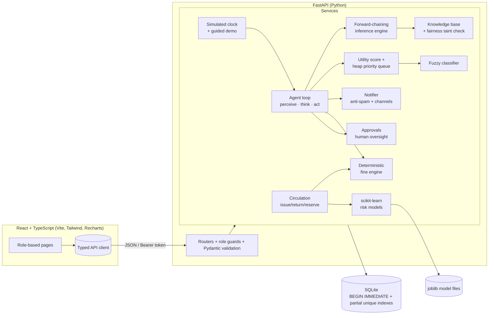
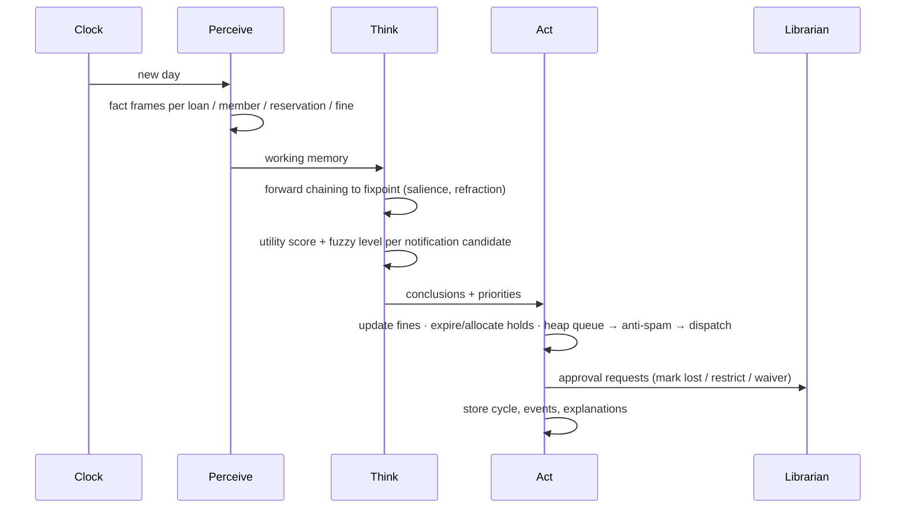

# Circulus — Intelligent Library Circulation, Fine Calculation and Priority Notification Agent

A full-stack **AI agent** for a college library, built as a Fundamentals of AI microproject. On every simulated day the agent
**perceives** circulation (loans, due dates, returns, reservations, demand, member history, unpaid fines) and **thinks** with a
forward-chaining expert system, fuzzy logic and a weighted utility function. It then **acts**: it calculates fines, prioritises and
sends notifications through a heap-based queue, allocates reserved books and recommends actions to librarians. Every decision is
stored and explained in the UI.

Everything runs **locally**. There are no paid APIs and no external services (SQLite, FastAPI, React, scikit-learn).

---

## Quick start

Requirements: **Python 3.10+** and **Node.js 18+** (npm).

```bash
python run.py
```

The website opens automatically at **http://localhost:8000** once the server is ready. On first run this creates `backend/.venv`, installs dependencies, builds the frontend, seeds
the database (about 10 s) and starts the server. Later runs start in a few seconds.

| Command | What it does |
|---|---|
| `python run.py` | Install (first time), build, seed (first time) and serve on :8000 |
| `python run.py --reset` | Wipe and re-seed the database, then serve |
| `python run.py --test` | Run backend (pytest) and frontend (Vitest) tests |
| `python run.py --dev` | Hot-reload mode: API on :8000 and Vite dev server on :5173 |
| `python run.py --no-browser` | Start without opening the website automatically |
| `python ai_outputs.py` (same as `python run.py --console`) | Print every AI technique's output in the terminal (no website); also saved to `outputs/ai_outputs.txt` |
| `python run.py --verbose` | Also log one line per web request |

<details>
<summary>Manual steps (if you prefer)</summary>

```bash
cd backend
python -m venv .venv
.venv/bin/pip install -r requirements.txt        # Windows: .venv\Scripts\pip install -r requirements.txt
.venv/bin/python -m app.seed --reset
cd ../frontend && npm install && npm run build
cd ../backend && .venv/bin/python -m uvicorn app.main:app --port 8000
```
</details>

## Using VS Code

The project includes ready-made VS Code settings (`.vscode/`).

1. **File → Open Folder…** and choose the `FAI` folder. Accept the prompt to install the recommended extensions (Python + Python Debugger).
2. **Press `F5`** (or **Run → Start Debugging**) and pick **"Run Library Agent (opens in browser)"** if VS Code asks.
   - The **Terminal** panel shows every step (install → build → seed) and then the live server log, one line per request.
   - When the server is ready you'll see `✔ Website is ready: http://localhost:8000`, and the site **opens in your browser automatically**.
3. **Watch the agent in the Terminal panel.** Everything the agent does is printed live:
   - each cycle's percepts, the rules that fired and the HIGH_RECALL_PRIORITY decisions;
   - every notification, with its level, channel and score;
   - fine updates, recommendations and approval requests;
   - every librarian or member action.

   For example, use **Agent control → Run one cycle** or **Play full demo** in the website and watch the terminal.
4. **Stop** with the red ■ button (or `Shift+F5`) or press `Ctrl+C` in the terminal; the server shuts down cleanly.

**Terminal-only AI outputs (no website):** open **`ai_outputs.py`** and click the ▶ **Run Python File** button (or run `python ai_outputs.py`), or choose **"Show AI outputs in the terminal (no website)"** in the F5 dropdown (or **Terminal → Run Task…**). It prints 11 sections:
1. PEAS
2. Day-by-day fine statement
3. Forward-chaining trace
4. Fuzzy memberships and rules
5. Utility-score breakdown
6. Heap dispatch order
7. Anti-spam decisions
8. ML metrics, confusion matrices and prediction factors
9. Fairness-guard rejection
10. A full agent cycle
11. The guided scenario

The output is saved to `outputs/ai_outputs.txt`, which you can paste into your report; a sample is in `docs/SAMPLE_AI_OUTPUT.txt`. It runs on a temporary copy of the database, so your data is never changed.

**Open the website inside VS Code instead:** **Terminal → Run Task… → "Run Library Agent inside VS Code"**. The server starts in the Terminal panel and the site opens in a VS Code browser tab. Any time later you can also run **`Ctrl+Shift+P` → "Simple Browser: Show"** → `http://localhost:8000`.

| VS Code entry | Where | What it does |
|---|---|---|
| Run Library Agent (opens in browser) | `F5` / Run and Debug | Normal start; opens your browser; live agent output in the terminal |
| Show AI outputs in the terminal (no website) | Run and Debug / Run Task | Prints all AI results in the terminal and saves them to `outputs/ai_outputs.txt` |
| Run Library Agent (reset demo data first) | Run and Debug | Re-seeds the database, then starts |
| Debug backend with breakpoints | Run and Debug | Runs the API under the debugger so breakpoints in `backend/app/...` stop (run the app once first so `backend/.venv` exists) |
| Run Library Agent inside VS Code | Terminal → Run Task | Starts the server and opens the site in a VS Code tab |
| Run all tests | Terminal → Run Task (or `Ctrl+Shift+P` → "Tasks: Run Test Task") | pytest + Vitest output in the terminal |
| Run in developer mode (hot reload) | Terminal → Run Task | API + Vite dev server; edits reload instantly |

`Ctrl+Shift+B` also runs the default task, the normal start.

## Demo logins (also shown on the login page)

| Role | Email | Password | Can do |
|---|---|---|---|
| Admin | `admin@library.local` | `Admin@123` | Users, policies, holidays, agent settings, KB editing, ML retraining, all analytics |
| Librarian | `librarian@library.local` | `Librarian@123` | Books, circulation, fines, approvals, notifications, agent control |
| Member | `member@library.local` | `Member@123` | Search, own loans/renewals, reservations, fines, notifications (student Aarav Sharma) |

All 35 other seeded members can also sign in, each with their college email (e.g. `meera.iyer@college.edu`) and `Member@123`. The login page has a searchable list of these accounts; click one to fill the form.

- **Create account** (tab on the login page): anyone can register as a library **member** (student, faculty or staff) with their own email and password. Staff accounts can only be created by an admin, in Administration → Users.
- **Change password**: available from the sidebar for every account. Members added by a librarian start with `Member@123` and should change it.

## Feature overview

**Library operations**
- Catalogue of 112 real titles with 247 barcoded physical copies (available / on loan / on hold / lost / maintenance), with search, filters and sorting.
- 36 members (students, faculty, staff) and role-based accounts with PBKDF2-hashed passwords and signed tokens.
- Issue, return, renew and reserve, with a FIFO reservation queue. A returned copy is allocated to the next member automatically, and holds that aren't collected expire.
- Configurable borrowing limits, loan periods, renewal limits, hold windows and fine slabs per member type.
- Full circulation history, approvals queue and audit log.

**The intelligent agent**
- **PEAS model and environment classification** on the *About the agent* page.
- **Sense-think-act loop**: every cycle stores its percepts, rule firings, decisions, actions and explanations.
- **Forward-chaining expert system**: 19 editable rules with salience, refraction and chaining to a fixpoint, plus a rule sandbox.
- **Deterministic fine engine**: slab rates, grace period, holidays and Sundays excluded, caps, lost-book charges, partial payments, and waivers that require a reason. Every fine has a day-by-day statement.
- **Priority notifications**: a 0-100 weighted utility score, fuzzy levels (Critical/High/Medium/Low) and a heap priority queue. Cooldowns, duplicate suppression and daily limits prevent spam. The channel (in-app, or simulated email/SMS) depends on priority and member preference, and every notice carries a "why was this sent" explanation.
- **Machine learning**: a reproducible synthetic dataset (clearly labelled), with Logistic Regression and Decision Tree compared on accuracy, precision, recall, F1, AUC, confusion matrix and feature importance. Each prediction shows its own factors, and there is a retrain button with model selection.
- **Fairness and oversight**: no sensitive attributes are used. Predictions are advisory only, and a taint analysis rejects any rule that would penalise based on a prediction. Waivers, restrictions and lost-book declarations need librarian approval.

**Simulation for the viva**
- A simulated clock: +1 day, +7 days, reset, run one cycle, or auto mode. Optional background member activity.
- A **one-click guided demo**: a reserved book goes overdue → priority rises → recall sent (with a duplicate suppressed) → Critical escalation → fine with a holiday excluded → return → automatic allocation → partial payment. Each step's reasoning appears on a live timeline.

## Pages

Dashboard (staff and member versions) · Catalog · Members · Circulation / My loans · Reservations · Fines (with fine calculator) ·
Approvals · Notification center (heap queue view) · Agent control center · Explainability (cycle traces, live loan reasoning,
notification reasoning, fuzzy playground) · Knowledge base editor · ML insights · Analytics · About the agent · Administration · Audit log.

Light and dark themes, responsive down to 360 px, keyboard navigable, with labelled forms, live regions and table views for every chart.

## Architecture



**Agent cycle (one simulated day)**



### Project layout

```
backend/
  app/
    main.py            FastAPI app (also serves the built frontend)
    models.py          SQLAlchemy models (users, members, books, copies, loans, reservations, fines, payments,
                       waivers, holidays, approvals, notifications, rules, settings, agent_cycles, agent_events,
                       ml_models, audit_logs)
    services/          agent, inference, knowledge_base, fuzzy, priority, notifier, fines, circulation,
                       oversight, ml, simulation, demo, settings, audit
    routers/           REST endpoints per area
    seed.py            deterministic demo data + 21-day warm-up through the real agent loop
  tests/               pytest suite (74 tests)
frontend/
  src/lib/             API client, types, scoring mirror, roles, validation, formatting
  src/components/      UI kit, charts, explanation views, layout
  src/pages/           one file per page
  src/test/            Vitest suite (21 tests)
docs/                  PROJECT_REPORT.md, VIVA_GUIDE.md
run.py                 one-command launcher
```

## Testing

```bash
python run.py --test
```

- **Backend (pytest, 74 tests):** fine engine (grace, slabs, holidays, Sundays, caps, lost books, partial payments, waivers); forward chaining (chaining order, negation, refraction, rule comparisons, disabled rules, proof chains); KB validation and the fairness guard; utility scoring, fuzzy memberships and levels, heap ordering and channels; cooldowns, escalation override, duplicate suppression and daily limits; reservation allocation (FIFO, holds, cancellation hand-off); concurrent issue and return-vs-reserve races; role-based permissions; agent cycles, approvals, ML, and the **full guided demo scenario**.
- **Frontend (Vitest, 21 tests):** scoring parity with the backend, fuzzy functions, queue ordering, role routing, form validation, formatting, API error handling and accessible components.

## Known limitations

- Email and SMS are **simulated**: they are stored and shown in the UI, never sent.
- The ML dataset is **synthetic**, so the metrics show the method, not real-world accuracy.
- Auto mode is driven by the open browser tab. It pauses if you close the app.
- SQLite with serialised write transactions is ideal for a single-machine demo, not for many concurrent users.
- **Reset simulation** re-runs the seeder, so any data you created is discarded.
